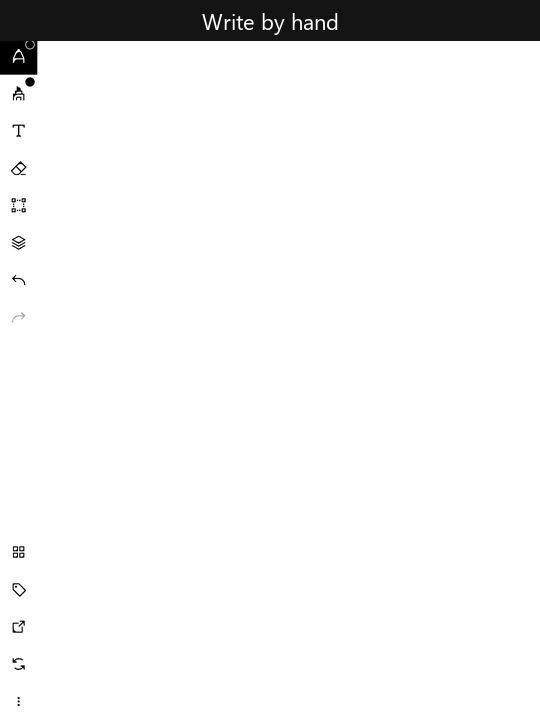

# rmpp-hwr

*Lasso your handwriting and tap Convert: typed text on the line where you wrote it, or a text object you can move and edit (v0.3).*

**Open handwriting recognition for the reMarkable Paper Pro, running on the tablet itself**: no cloud, no account,
your notes never leave the device. Select handwriting with the lasso and turn it into clean text or tidy pen
strokes, recognize a whole page, and train a model on your own handwriting.

It starts with Korean, English and digits, and grows with the reMarkable community: the open dataset
[rmpp-hwr-db](https://github.com/lorancecall/rmpp-hwr-db) collects handwriting in many languages from people who
write on the tablet, `hwr contribute` shares your practice pages to it (anonymized, CC BY 4.0), and the public
models are trained on it regularly. Every language that gathers writers there can be recognized here next.

> Part of the **rmpp add-ons**, built on [rmpp-packages](https://github.com/lorancecall/rmpp-packages): it is
> installed by rmpp setup, loaded into xochitl at every boot by rmpp-preload (no xovi), and kept up to date with
> Vellum. How that differs from xovi: [how it works](https://github.com/lorancecall/rmpp-packages/blob/main/docs/how-it-works.md).
>
> Status: experimental.

On the tablet:

- **Lasso convert** (lasso menu): select handwriting with the lasso and tap the convert button (the "aa" icon in a
  dashed box). The recognized text is typed into the page on the line where you wrote it, or, in text object mode,
  drawn as a **text object** by [rmpp-textobj](https://github.com/lorancecall/rmpp-textobj) (ordinary pen strokes in
  the language's font that you can move, resize and edit as text; needs rmpp-textobj and rmpp-lang). Text objects in
  the selection are not recognized again: their text is used as it is. Settings > Handwriting switches the lasso
  button back to reMarkable's own Convert to text.
- **Convert page** (toolbar, next to Convert to text): recognizes the whole page and types it on a new page.
- **Models** (Settings > Handwriting): pick the recognition model. The models of the installed packages
  (`rmpp-hwr-ko`, `rmpp-hwr-en`, ...) are listed, and models you trained yourself in
  `/home/root/.local/share/rmpp-hwr/models/<name>/` (`rec.onnx`, `dict.txt`, `model.txt`; listed by the first line of
  `model.txt`). "Off" turns rmpp-hwr's recognizer off: the lasso button is reMarkable's own Convert to text and
  Convert page is hidden.

## Install

- Install **rmpp setup** (desktop app or one-line script) from
  [rmpp-packages](https://github.com/lorancecall/rmpp-packages#install) and tick **rmpp-hwr** (not preselected); the
  Korean model comes with it, the other languages' models are listed under it. For text object mode tick
  **rmpp-textobj** as well. Developer mode is needed: the rmpp-packages page explains it.
- After a reMarkable OS update: **Restore** in rmpp setup.
- Other ways (Vellum on the command line, the release files, `hwr install` and building it yourself) and removal:
  [docs/install.md](docs/install.md).

## What is here

| Path | What |
|---|---|
| `src/` | Rust recognizer: reads `.rm` pages, renders lines, runs the PaddleOCR PP-OCRv5 Korean recognition model (ONNX, onnxruntime). Also exports the typed text of a page. |
| `ui/` | xochitl add-on (LD_PRELOAD): lasso convert (`ui/ink.h`: typed text, or a text object through rmpp-textobj's C API), "Convert page" in the toolbar, Settings > Handwriting (records, corrections, model info). `ui/exp/`: experiments for the developer loader (`DEV=1 ui/build.sh`). |
| `model/` | base model `rec.onnx` + `dict.txt` (PaddleOCR `korean_PP-OCRv5_mobile_rec`, Apache-2.0, see NOTICE). |
| `collect/` | practice notebooks (v1 lines, v2 structured pages with per-character cells), pulling handwriting from the tablet, line/character images. |
| `tools/hwr` | one command for the whole loop: `practice`, `pull`, `qc`, `upload`, `train`, `fetch`, `eval`, `deploy`, `contribute`, ... |
| `train/` | fine-tuning jobs that run on a local GPU or a Slurm cluster, configured by `.env` (see `train/README.md`). |
| `references/` | literature notes on improving personal handwriting recognition (cumulative). |

## Guides

- [WORKFLOW.md](WORKFLOW.md): from practice notebook to personal model on the tablet.
- [train/README.md](train/README.md): training backends (`.env`: local GPU or Slurm), jobs, known pitfalls.
- [references/README.md](references/README.md): what to try next and why.
- [references/convert-to-ink.md](references/convert-to-ink.md): how Convert to ink works inside xochitl (findings,
  internals used, limits).
- Open dataset: [rmpp-hwr-db](https://github.com/lorancecall/rmpp-hwr-db), the community's handwriting in many
  languages (how to take part, in every supported language: https://lorancecall.github.io/rmpp-hwr-db/).
  `hwr contribute` shares structured practice pages, anonymized; your language is missing? Ask for it there.

## Privacy

No personal data goes into this repository or into contributed data: machine-specific settings live only in the
gitignored `.env`, and `hwr contribute` sends random writer ids, practice templates and pen strokes only.

## License

GPL-3.0-only (see LICENSE). Third-party components: see NOTICE.
